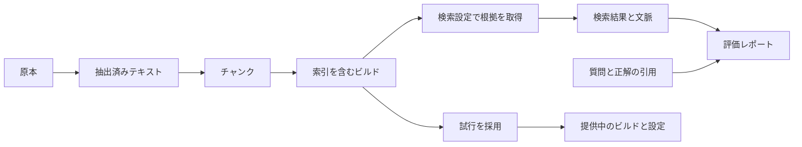

# データ・ビルド・評価の関係

MCP・RAG では、資料の版を固定したビルドを作り、そのビルドを検索や評価の対象にします。設定を変えた結果は試行として作り、検索してから採用できます。

| 用語 | 役割 |
| --- | --- |
| ビルド | 原本、抽出結果、チャンク、索引の版をまとめます。`build_id` で指定できます。 |
| 検索設定 | 検索方式、取得件数、文脈の文字数などを決めます。検索結果には実行時の `search_config_id` が入ります。 |
| ビルドのタグ | ビルドと検索設定の組に付ける名前です。`search --build`、`eval --build`、`release` で参照します。 |
| 評価データ | 質問と正解の引用、調整用・最終確認用の分割を持ちます。 |
| 評価レポート | 特定のビルドと検索設定を、特定の評価データと方法で測った記録です。レポートのタグは `report compare` で使います。 |

## 変更した段階から作る

文書を更新するときは `build` で取り込みから進めます。チャンクの大きさを試すときは `--from transform` で抽出済みの結果を使います。ユーザー辞書だけを変えるときは `--from index --input <build>` でチャンクを固定できます。

## 試行を測り、提供へ反映する

`build --config ... --tag ...` で作った試行は、`search --build` で確認します。`eval --build` で基準と試行を同じ評価データに対して測り、`report compare` で結果を比較します。採用を決めたら `use` を実行し、稼働中の `serve` を起動し直して設定を反映します。

`status` には現在のビルド、検索設定、評価の鮮度が表示されます。資料・設定・評価データが変わった後に最新の状態を測るには、対象を固定して評価を実行します。 [評価の手順](evaluation.md) · [試行と採用の仕様](knowledge-nest-spec.md#11-試行採用外部エージェントによる最適化)
